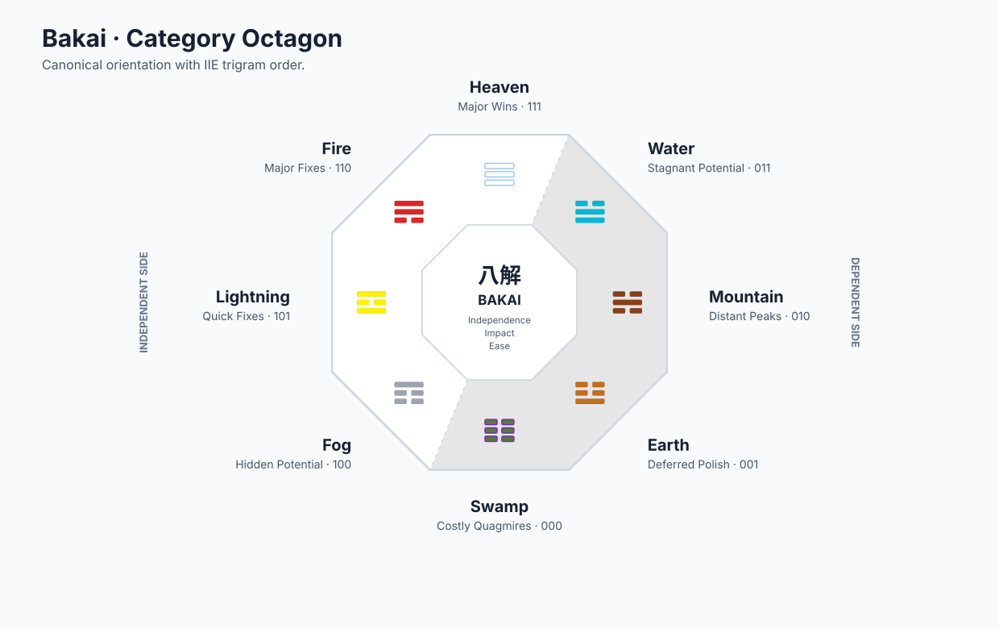

# Bakai · 八解

**An eight-category prioritization matrix for issues and work.**

Bakai combines Impact, Ease and Independence to classify work into eight actionable categories. It also makes the potential value of unblocking other work visible through Unlocking Power.

## How it works

| IIE | Element | Category | Color |
|---|---|---|---|
| 111 | Heaven | Major Wins | `#EAF6FF` |
| 110 | Fire | Major Fixes | `#DC2626` |
| 101 | Lightning | Quick Fixes | `#FFF200` |
| 100 | Air | Hollow Fixes | `#9CA3AF` |
| 011 | Water | Locked Potential | `#06B6D4` |
| 010 | Mountain | Distant Peaks | `#874018` |
| 001 | Earth | Deferred Polish | `#C26D1F` |
| 000 | Swamp | Costly Quagmires | `#567A37` |

Score Impact and Ease from 1 to 10 (6–10 is high). Independence is binary. Read the three bits in Independence / Impact / Ease (IIE) order, from most to least significant. Use the dependency graph to determine execution order rather than treating categories as a universal ranking.

## Containment Splitting

Consider separating a rapid containment intervention from the definitive fix:

- **Dependency-driven:** Fire and Air with positive Unlocking Power.
- **Impact-driven:** Fire, Water and Mountain.

Reclassify both resulting issues and update their dependencies.

## Explore

- [Full documentation](docs/bakai.md)
- [Bagraph interactive visualization source](docs/bagraph.html) — open via [GitHub Pages](https://abalbastrem.github.io/bakai/bagraph.html) or a local HTTP server; GitHub's file preview does not execute HTML.
- [Presentation page](docs/index.html)

## Bagraph data sources

- [Issues](docs/data/issues.md): edit the Markdown table (ID, Title, Impact, Ease).
- [Dependencies](docs/data/dependencies.md): edit the Mermaid graph; an arrow points from prerequisite to dependent.
- [Bagraph JavaScript](docs/bagraph.js): computes Independence, octant, downstream count and Unlocking Power, then renders the plot and issue table.

Only unresolved issues and unresolved dependencies belong in this dataset. Do not duplicate derived values in the source files. Bagraph validates scores, unique IDs, graph references, duplicate edges and cycles. A shared downstream issue is counted once per ancestor. Unlocking Power measures potential downstream impact, not guaranteed immediate unblocking.

Use one pipe-delimited row per issue (no literal pipes inside titles) and one `ID --> ID` edge per line in a single Mermaid graph block. Isolated issues need no graph entry. Reload Bagraph after changing the files.

For local use, run `python -m http.server 8000 --directory docs` from the repository root and visit `http://localhost:8000/bagraph.html`. Opening the HTML directly with `file://` will not work because it fetches Markdown over HTTP. Plotly is loaded from a CDN and requires internet access.

The two SVGs describe the method and its eight categories independently of any dataset. Bagraph reads the current Markdown issue and dependency data dynamically.

The interactive Bagraph uses fictional software issues. Bakai is a proposed practical framework inspired by eight-element symbolism, not a traditional Bagua system. This is an early version.
