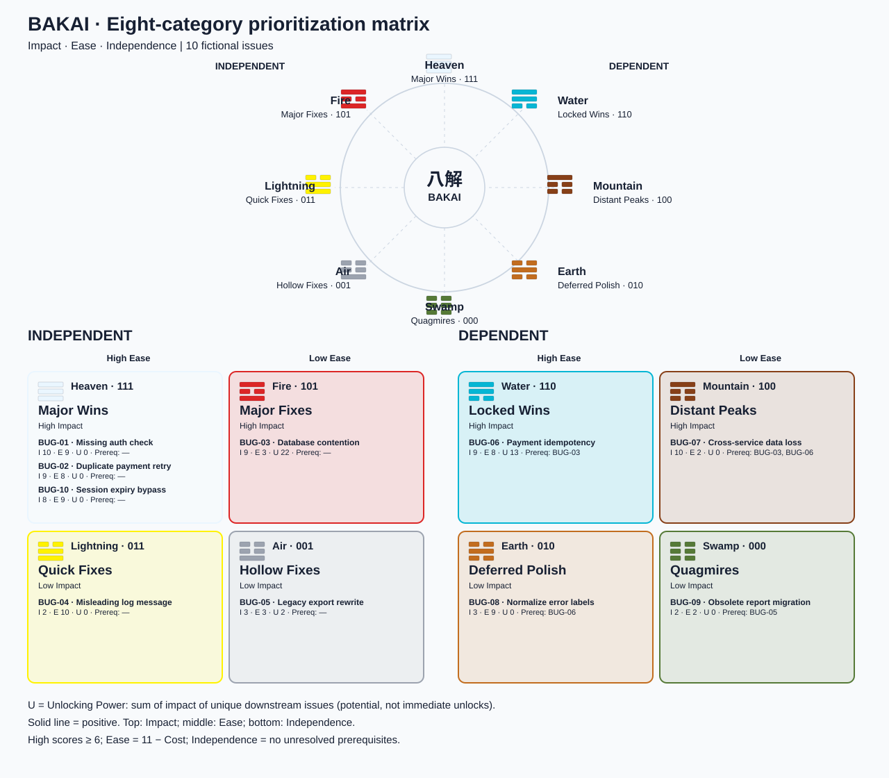

# Bakai · 八解

**An eight-category prioritization matrix for issues and work.**

Bakai combines Impact, Ease and Independence to classify work into eight actionable categories. It also makes the potential value of unblocking other work visible through Unlocking Power.

## How it works

| IEI | Element | Category | Color |
|---|---|---|---|
| 111 | Heaven | Major Wins | `#EAF6FF` |
| 101 | Fire | Major Fixes | `#DC2626` |
| 011 | Lightning | Quick Fixes | `#FFF200` |
| 001 | Air | Hollow Fixes | `#9CA3AF` |
| 110 | Water | Locked Wins | `#06B6D4` |
| 100 | Mountain | Distant Peaks | `#874018` |
| 010 | Earth | Deferred Polish | `#C26D1F` |
| 000 | Swamp | Quagmires | `#567A37` |

Score Impact and Ease from 1 to 10 (6–10 is high). Independence is binary. Read the three bits in that order. Use the dependency graph to determine execution order rather than treating categories as a universal ranking.

## Containment Splitting

Consider separating a rapid containment intervention from the definitive fix:

- **Dependency-driven:** Fire and Air with positive Unlocking Power.
- **Impact-driven:** Fire, Water and Mountain.

Reclassify both resulting issues and update their dependencies.

## Explore

- [Full documentation](docs/bakai.md)
- [Bagraph interactive visualization source](docs/bagraph.html) — open locally in a browser or via GitHub Pages; GitHub's file preview does not execute HTML.
- [Presentation page](docs/index.html)

The visualizations use fictional software issues. Bakai is a proposed practical framework inspired by eight-element symbolism, not a traditional Bagua system. This is an early version.
