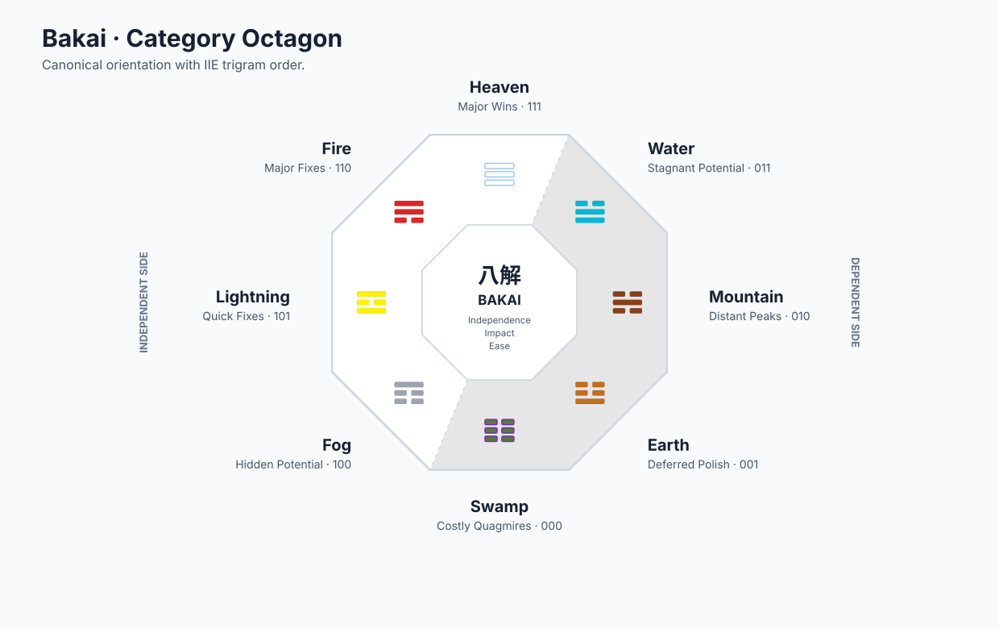
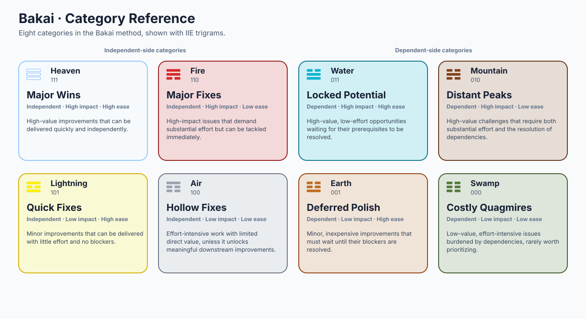

# Bakai · 八解

[Bagraph — interactive 3D visualization](./bagraph.html)

## Dimensions (IIE bit order)
- Independence
- Impact
- Ease

## Category descriptions

| IIE | Element | Category | Description |
|---|---|---|---|
| 111 | Heaven | Major Wins | High-value improvements that can be delivered quickly and independently. |
| 110 | Fire | Major Fixes | High-impact issues that demand substantial effort but can be tackled immediately. |
| 101 | Lightning | Quick Fixes | Minor improvements that can be delivered with little effort and no blockers. |
| 100 | Air | Hollow Fixes | Effort-intensive work with limited direct value, unless it unlocks meaningful downstream improvements. |
| 011 | Water | Locked Potential | High-value, low-effort opportunities waiting for their prerequisites to be resolved. |
| 010 | Mountain | Distant Peaks | High-value challenges that require both substantial effort and the resolution of dependencies. |
| 001 | Earth | Deferred Polish | Minor, inexpensive improvements that must wait until their blockers are resolved. |
| 000 | Swamp | Costly Quagmires | Low-value, effort-intensive issues burdened by dependencies, rarely worth prioritizing. |

## Point semantics in the interactive chart
- **Circle**: issue that does **not** unlock downstream issues.
- **Diamond**: issue that **does** unlock downstream issues.
- **Marker size**: increases with **Unlocking Power**, with a capped display size in Bagraph.

## Notes
- Bit order and trigram order: top = Independence, middle = Impact, bottom = Ease.
- High Impact if score ≥ 6.
- High Ease if score ≥ 6, where Ease = 11 − Cost.
- Independent means no unresolved prerequisites.

- Plot geometry: integer scores 1–10, displayed from 0.5 to 10.5; split at 5.5 for equal octants.
- Mountain: `#874018`; Earth: `#c26d1f`.

## Bagraph reference implementation

The two sources of truth for the example dataset are [issues.md](./data/issues.md) and [dependencies.md](./data/dependencies.md). Issues specify Impact and Ease on the integer scale 1–10. The Mermaid graph uses arrows from unresolved prerequisites to their dependents. Independence is derived from the absence of incoming edges.

Unlocking Power is the sum of the Impact scores of all distinct reachable downstream issues, including indirect descendants. This is a potential benefit rather than a guarantee that completing one prerequisite will immediately unblock every descendant. The dependency graph must be acyclic.

Bagraph computes these metrics and the octant from the Markdown data at page load. The issue table and point markers are generated from the same computed records. The two static SVGs illustrate the method and its category definitions, not a particular issue dataset.

## Containment Splitting

Containment Splitting is the decomposition of an issue into a short-term containment or workaround and a long-term root cause fix. Its purpose is to deliver useful results sooner without requiring the full resolution upfront.

### Dependency-driven Splitting

**Candidates:** independent issues with Low Ease and positive Unlocking Power.

- **Fire (110) — Major Fixes**
- **Air (100) — Hollow Fixes**

The goal is to unblock downstream work through a smaller, easier intervention. The original issue's own Impact does not determine eligibility. A split is useful only if containment actually removes or satisfies a dependency earlier than the full fix would.

### Impact-driven Splitting

**Candidates:** High Impact issues that have Low Ease or are Dependent.

- **Fire (110) — Major Fixes**
- **Water (011) — Locked Potential**
- **Mountain (010) — Distant Peaks**

The goal is to mitigate harm while the definitive fix is difficult, time-consuming or blocked. Unlocking Power is not required. For example, temporarily disabling an affected production operation may reduce harm before the underlying defect can be fixed.

### Candidate matrix

| IIE | Element | Category | Dependency-driven | Impact-driven |
|---|---|---|---|---|
| 111 | Heaven | Major Wins | — | — |
| 110 | Fire | Major Fixes | If Unlocking Power > 0 | Yes |
| 101 | Lightning | Quick Fixes | — | — |
| 100 | Air | Hollow Fixes | If Unlocking Power > 0 | — |
| 011 | Water | Locked Potential | — | Yes |
| 010 | Mountain | Distant Peaks | — | Yes |
| 001 | Earth | Deferred Polish | — | — |
| 000 | Swamp | Costly Quagmires | — | — |

Fire belongs naturally to both modalities. A single containment intervention may both mitigate harm and unblock downstream work. These are screening criteria, not mandatory splits or absolute exclusions.

### Reclassification after splitting

1. Identify a viable containment intervention and a definitive root cause fix.
2. Score each resulting issue independently on Impact, Ease and Independence. A rapid, independent containment intervention may move to Heaven or Lightning, depending on its own Impact.
3. Update dependency links to reflect which intervention actually satisfies each prerequisite. Retain dependencies on the root cause fix where containment is insufficient.
4. Recalculate Unlocking Power across the affected dependency graph, avoiding double-counting shared downstream issues.
5. Compare the benefit of earlier containment or unblocking against the additional effort and risk of maintaining a temporary solution. If splitting offers no meaningful benefit, retain the original issue.

Classification informs prioritization; actual execution order must respect unresolved prerequisites.
