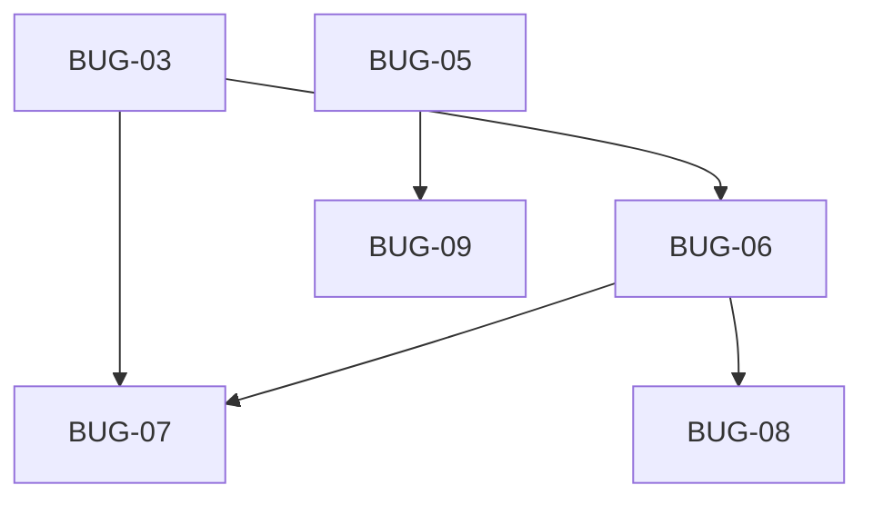

# Dependencies

Each arrow points from an unresolved prerequisite to the issue that depends on it. An issue with no incoming arrow is independent. Use one `PREREQUISITE --> DEPENDENT` edge per line; isolated issues need not appear here.

